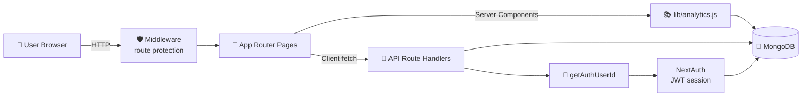
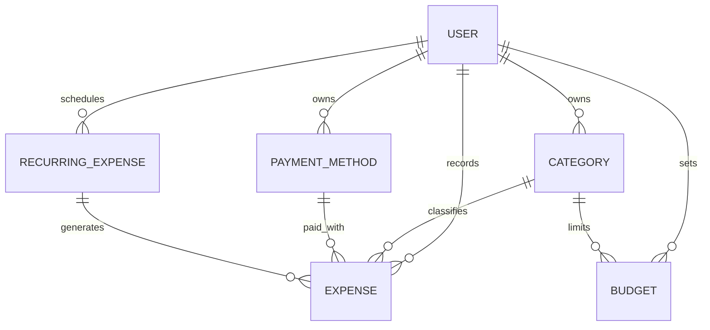

<div align="center">

# 💸 Ledger — Personal Expense Tracker

### *Record an expense in seconds, understand your spending in minutes.*


**A clean, fast, mobile-first expense tracker with beautiful charts, a spending calendar, budgets and fully customizable categories.**

[✨ Features](#-features) · [🧭 Pages](#-pages-and-navigation) · [🏗️ Architecture](#️-architecture) · [🚀 Getting Started](#-getting-started) · [🔌 API](#-api-reference)

</div>

---

## 📖 Table of Contents

1. [What is Ledger?](#-what-is-ledger)
2. [Features](#-features)
3. [Pages and Navigation](#-pages-and-navigation)
4. [Tech Stack](#-tech-stack)
5. [Architecture](#️-architecture)
6. [Project Structure](#-project-structure)
7. [Data Models](#-data-models)
8. [API Reference](#-api-reference)
9. [Design System](#-design-system)
10. [Security](#-security)
11. [Getting Started](#-getting-started)
12. [Current Scope and Roadmap](#-current-scope-and-roadmap)

---

## 🌟 What is Ledger?

**Ledger** is a full-stack personal finance web app built with **Next.js (App Router)**, **MongoDB** and **NextAuth**. It helps you:

- ⚡ **Log** an expense in a few taps from any screen
- 📊 **See** where your money goes with charts and summaries
- 🗓️ **Spot** your heavy-spending days on a colour-coded calendar
- 🎯 **Control** your spending with a monthly budget and live progress bars
- 🎨 **Personalize** categories and payment methods to fit your life

Amounts are shown in **Indian Rupees (₹)** and formatted with the Indian digit grouping (e.g. `₹1,25,000`). Every amount is rendered in a **monospaced, tabular-figure font**, which gives the app a receipt / ledger-book feel and keeps numbers perfectly aligned.

---

## ✨ Features

### 🔐 1. Authentication and Accounts

| Feature | Details |
|---|---|
| **Email + password sign-up** | Register with full name, email and password. Input is validated on the server with **Zod** (name required and up to 100 characters, valid email, password of at least 8 characters). |
| **Duplicate protection** | Registering with an email that already exists returns a clear "account already exists" message. |
| **Secure password storage** | Passwords are hashed with **bcrypt (12 salt rounds)**. Plain-text passwords are never stored. |
| **Auto sign-in after sign-up** | As soon as the account is created, the user is signed in and sent straight to the dashboard. |
| **Email + password login** | Credentials are checked against the hashed password. Errors are deliberately generic ("Invalid email or password.") so attackers cannot tell which part was wrong. |
| **Google sign-in (optional)** | A **"Continue with Google"** button is available. The Google provider is enabled only when `GOOGLE_CLIENT_ID` is set. First-time Google users get an account created automatically. |
| **Stateless JWT sessions** | Sessions use JSON Web Tokens. The database user id is embedded in the token and exposed on the session as `session.user.id`. |
| **Smart home redirect** | Visiting `/` sends logged-in users to `/dashboard` and everyone else to `/login`. |
| **Sign out** | Available from the desktop sidebar and from the Settings page. It returns the user to the login screen. |
| **Friendly auth forms** | Inline error messages, loading states ("Signing in…", "Creating account…"), and cross-links between the Login and Register pages. |

### 🎁 2. Instant Onboarding (Default Data)

When a new account is created (by email or Google), Ledger **automatically seeds** everything needed to start tracking right away.

**13 default categories** (each with an emoji icon and a colour):

| Icon | Category | Icon | Category |
|---|---|---|---|
| 🏠 | Rent | 🎬 | Entertainment |
| 🍔 | Food & Dining | 🏥 | Health & Medical |
| ⛽ | Petrol / Fuel | 📚 | Education |
| 🚗 | Vehicle Expenses | ✈️ | Travel |
| 🛍️ | Shopping | 💼 | Work / Professional |
| 💡 | Bills & Utilities | 📦 | Miscellaneous |
| 🎁 | Gifts | | |

**6 default payment methods:** `Cash` · `UPI` · `Credit Card` · `Debit Card` · `Bank Transfer` · `Net Banking`

> 🛟 **Self-healing:** if a user's category or payment-method list is ever found empty, the `GET /api/categories` and `GET /api/payment-methods` endpoints re-create the defaults automatically.

### ➕ 3. Quick-Add Expense (Add Expense Modal)

Logging an expense is designed to take seconds.

- 🔘 **Always within reach**
  - **Desktop:** a floating **"Add expense"** button fixed to the bottom-right corner on every page.
  - **Mobile:** a large round **"+" button** in the centre of the bottom navigation bar.
- 📱 **Adaptive layout:** on mobile the form slides up from the bottom as a *bottom sheet* (with safe-area padding for notched phones); on desktop it appears as a centred modal. The background is dimmed and blurred.
- 🧾 **Fields**
  - **Amount (₹)**, with a large mono input, decimal keypad on mobile (`inputMode="decimal"`), and auto-focus.
  - **Category chips**, tappable "stamp"-style pills with icon and name. The first category is pre-selected.
  - **Date & time**, using the native datetime picker, pre-filled with the *current local time* and converted to a UTC instant when saved.
  - **Payment method**, a dropdown, with the first method pre-selected.
  - **Notes (optional)**, a free-text description such as *"Lunch with friends"*.
- ✅ **Validation and feedback:** an amount greater than zero is required. Server errors show inline. On success a green confirmation (*"Expense of ₹X added successfully."*) appears and the modal closes itself after ~0.9 seconds.
- 🔄 **Instant refresh:** after saving, the page data refreshes automatically (`router.refresh()`), so the dashboard numbers and charts update without a reload.
- 🔒 **Scroll lock:** the page behind the modal is locked from scrolling while it is open.
- 🧠 **Sticky choices:** after saving, the selected category and payment method are remembered for the next entry.

### 🏠 4. Dashboard (Your Financial Snapshot)

A personalized home screen with a greeting (*"Good to see you, \<first name\> 👋"*) and today's full date.

**Four summary cards**

| Card | What it shows |
|---|---|
| 💰 **Today's spending** | Total spent today and the number of transactions. |
| 📅 **\<Month\> spending** | Total for the current month, plus a **trend badge** comparing it with last month (↗ red when spending is up, ↘ green when it is down, with the exact percentage). |
| 📈 **Daily average** | Average spend per day (over the days that had spending) in the current month. |
| 🏆 **Top category** | The category you spent the most on this month, with its icon and total. |

**Visual insights**

- 📉 **"Spending this month" area chart:** a smooth gradient trend line of daily spending.
- 🍩 **"By category" donut chart:** a colour-coded breakdown with a legend of your top 5 categories and their amounts.

**Recent transactions**

- Your **8 most recent** expenses with category icon (on a tinted circle in the category colour), category name, date and time, optional note, and amount.
- A friendly empty state ("No expenses yet") for new users.
- A **"View All"** button that jumps to the full Expenses page.

> ⚡ The dashboard is a **server component**. All figures are computed on the server with MongoDB aggregations and sent as ready-to-render HTML. The four data queries run in parallel for speed.

### 🧾 5. Expenses Page (Search, Filter, Sort, Paginate)

A complete history of every expense with powerful tools to find anything.

- 🔍 **Live search** on the expense description (case-insensitive), with a clear (✕) button.
- 🎛️ **Collapsible filter panel** with a badge showing how many filters are active.
  - **Category filter:** choose any one category or "All Categories".
  - **Time-period filter:** `All Time`, `Today`, `Yesterday`, `This Week` (Monday to Sunday), `This Month`, `Last Month`, `This Quarter`, `This Year`, or **`Custom Range`** with *From* and *To* date pickers (the "To" date cannot be earlier than "From").
  - **Sorting:** `Newest First`, `Oldest First`, `Highest Amount`, `Lowest Amount`.
- 🧹 **"Clear all" filters** in one click, plus a helpful empty state with a *Clear all filters* shortcut.
- 🔢 **Result counter** (e.g. "42 expenses found").
- 📄 **Pagination:** 20 expenses per page with numbered page buttons. The page resets to 1 whenever a filter changes.
- 🗑️ **Delete with confirmation:** a trash icon appears on hover. For data integrity it is only offered for expenses **created today**, and it asks *"Delete this expense? This cannot be undone."* before removing it.
- 🧩 Each row shows the category icon and colour, the category name with the note, the full date and time, the payment method, and the amount.

### 📊 6. Analytics (Deep-Dive Reports)

A time-travelling analytics screen for understanding your habits.

- 🗂️ **Range switcher:** `Week` · `Month` · `Quarter` · `Year`.
- ⏮️⏭️ **Period navigator:** step back through past weeks, months, quarters or years with the arrow buttons. The label updates automatically (e.g. `Oct 26 – Nov 1`, `November 2026`, `Q4 2026`, `2026`). The current period is tagged **(current)**, and you cannot navigate into the future.
- 🧮 **Four KPI cards:** **Total spent**, **Transactions**, **Daily average**, and **vs. previous period**, the percentage change against the immediately preceding period of the same length (red when higher, green when lower).
- 📉 **Spending trend:** a gradient area chart of daily totals.
- 🍩 **Category donut + legend** for the selected period.
- 💳 **"By payment method" breakdown:** how much you spent through Cash, UPI, cards and so on, sorted from highest to lowest.
- ⏳ Loading state while data is fetched.

> The analytics API also supports a `day` range and a `calendar` range (used by the Calendar page).

### 🗓️ 7. Spending Calendar (Heatmap)

A visual month view that makes spending patterns obvious at a glance.

- 🔥 **Heatmap colouring:** each day is shaded in **5 intensity levels** (none → light teal → dark teal), based on how that day's spending compares with the **highest-spend day of the month**.
- 💵 **Amounts inside the cells**, with compact formatting for thousands (e.g. `₹1.2k`).
- ◀️▶️ **Month navigation** with arrows. Data for the new month loads on demand.
- 👆 **Tap any day** to open a **day detail panel** listing every expense on that day: category icon, name, note and amount. Days without spending say *"No expenses on this day."*
- ✨ The selected day is highlighted with a ring.
- 📱 Square, touch-friendly cells in a 7-column Sunday-to-Saturday grid.

### 🎯 8. Budgets

Set a monthly spending limit and watch it in real time (in **Settings → Monthly budget**).

- 💼 **Overall monthly budget:** enter an amount in ₹ and save.
- 📏 **Live progress bar** showing `₹spent / ₹budget` for the current month.
- 🚦 **Smart status colours**

| Usage | Status | Bar colour |
|---|---|---|
| Below 75% | `ok` | 🟢 Teal |
| 75% – 89% | `warning` | 🟠 Amber |
| 90% – 99% | `critical` | 🔴 Coral |
| 100% or more | `exceeded` | 🔴 Coral + *"You've exceeded this budget."* |

- ⚠️ A percentage warning (*"X% of budget used."*) appears automatically once you pass the "ok" zone.
- 🧩 **Category budgets supported by the backend:** the API can store a budget for a single category (leave `categoryId` empty for the overall budget) and calculates its utilization separately.
- 🧮 Utilization is computed on the server from your actual expenses for the current calendar month.

### ⚙️ 9. Settings and Personalization

- 👤 **Profile card:** your name, email and currency (INR ₹).
- 🏷️ **Category manager**
  - **Add** a new category with a name, an **emoji icon** (15 choices: 📦 🍔 🏠 🚗 🛍️ 💡 🎬 🏥 📚 ✈️ 💼 🎁 ⛽ 🐾 💊) and a **colour** (10 swatches).
  - **Edit** the name, icon and colour inline.
  - **Delete**, but only if no expense uses it. Otherwise you get a clear message such as *"This category is used by 3 expenses and can't be deleted."* This keeps your history intact.
  - **Duplicate-name protection** (case-sensitive unique name per user).
  - Default categories carry a small **"default"** tag.
- 💳 **Payment-method manager:** add, rename and delete payment methods with the same in-use protection and duplicate checks.
- ✏️ Hover-to-reveal edit and delete icons keep the list tidy.
- 🚪 **Sign out** button.

### 📱 10. Responsive, Mobile-First Navigation

| Screen | Navigation |
|---|---|
| **Desktop / tablet (`md` and up)** | A sticky **left sidebar** with the Ledger logo, links to *Dashboard, Expenses, Calendar, Analytics, Settings* (active page highlighted), the signed-in user's name and email, and a **Sign out** link. |
| **Mobile** | A fixed **bottom navigation bar** with *Home, Analytics, ➕ (floating Add button), Calendar, Profile*. It respects the device **safe area** (home-indicator inset) and uses a frosted-glass blur background. |

The page content automatically gets extra bottom padding on mobile so nothing hides behind the nav bar. The expense list is reachable from the dashboard's **View All** button, and from the sidebar on larger screens.

### 🌗 11. Dark Mode-Ready Design

Every component ships with `dark:` styles (cards, inputs, borders, nav, charts' surroundings, heatmap levels), and the app's colours are designed around a deep green-black dark palette. See [Design System](#-design-system).

### 🛡️ 12. Route Protection

- **Edge middleware** blocks unauthenticated access to `/dashboard`, `/expenses`, `/calendar`, `/analytics` and `/settings`, redirecting to `/login`.
- A **server-side layout guard** double-checks the session before rendering any dashboard page.
- Every **API route** independently checks the session and returns `401 Unauthorized` if there is none.

### ⚡ 13. Performance and Engineering Touches

- **Cached MongoDB connection** that survives hot reloads in development and re-use across serverless invocations, which prevents connection-pool exhaustion.
- **Compound database indexes** on expenses for the most common query patterns (by user and date, by user, category and date, and by user and payment method).
- **MongoDB aggregation pipelines** (`$match`, `$group`, `$lookup`, `$unwind`, `$project`, `$sort`, `$dateToString`) do all the totals and groupings in the database.
- **Parallel queries** with `Promise.all` on the dashboard, analytics and expense listing.
- **Server components** for the dashboard and calendar pages (zero client JavaScript for the data fetching) and **client components** only where interaction is needed.
- **Sort whitelisting** on the expenses API, so clients can only sort by known fields.
- **Pagination limits** are clamped (1–100 per page) to protect the database.
- **Future-period guard** in the analytics API: positive offsets are rejected, and the current period's end is clamped to "now".

---

## 🧭 Pages and Navigation

| Route | Access | Type | Purpose |
|---|---|---|---|
| `/` | Public | Server | Redirects to `/dashboard` or `/login` depending on the session |
| `/login` | Public | Client | Email/password and Google sign-in |
| `/register` | Public | Client | Create an account |
| `/dashboard` | 🔒 Private | Server | Summary cards, trend chart, category donut, recent transactions |
| `/expenses` | 🔒 Private | Client | Searchable, filterable, sortable, paginated expense history |
| `/calendar` | 🔒 Private | Server + Client | Monthly spending heatmap with day details |
| `/analytics` | 🔒 Private | Client | Week / Month / Quarter / Year reports with period navigation |
| `/settings` | 🔒 Private | Client | Profile, budget, categories, payment methods, sign out |

---

## 🧰 Tech Stack

| Layer | Technology |
|---|---|
| **Framework** | Next.js (App Router, route groups, route handlers, middleware) |
| **UI library** | React (server and client components) |
| **Styling** | Tailwind CSS with custom design tokens and reusable component classes |
| **Charts** | Recharts (`AreaChart`, `PieChart`) |
| **Icons** | lucide-react |
| **Authentication** | NextAuth.js (Credentials + Google, JWT strategy) |
| **Password hashing** | bcryptjs |
| **Validation** | Zod |
| **Database** | MongoDB |
| **ODM** | Mongoose |

---

## 🏗️ Architecture



**How a request flows**

1. The **middleware** checks that the user is signed in before letting them reach a private page.
2. **Server-rendered pages** (Dashboard, Calendar) call helper functions in `lib/analytics.js`, which run MongoDB aggregations directly. No HTTP round-trip is needed.
3. **Interactive pages** (Expenses, Analytics, Settings) call the **REST-style API routes** with `fetch`.
4. Every API route calls `getAuthUserId()` and **scopes all queries by that user id**. The client never decides whose data it can see.

---

## 📁 Project Structure

```text
src/
├── middleware.js                    # Protects private routes (NextAuth middleware)
│
├── app/
│   ├── layout.js                    # Root layout: fonts, theme colour, SEO metadata, providers
│   ├── providers.js                 # NextAuth SessionProvider wrapper
│   ├── tailwind.css                 # Tailwind layers + custom component classes
│   ├── page.js                      # "/" → redirect based on session
│   │
│   ├── login/page.js                # Sign-in page (credentials + Google)
│   ├── register/page.js             # Sign-up page
│   │
│   ├── (dashboard)/                 # Route group: all private pages share one layout
│   │   ├── layout.js                # Server-side auth guard + DashboardShell
│   │   ├── dashboard/page.js        # Home: KPIs, charts, recent transactions
│   │   ├── expenses/page.js         # Full history with search, filters, pagination
│   │   ├── calendar/page.js         # Spending heatmap page
│   │   ├── analytics/page.js        # Week/Month/Quarter/Year reports
│   │   └── settings/page.js         # Profile, budget, categories, payment methods
│   │
│   └── api/
│       ├── auth/
│       │   ├── [...nextauth]/route.js    # NextAuth handler
│       │   └── register/route.js         # POST: create account
│       ├── expenses/
│       │   ├── route.js                  # GET (list/filter/paginate), POST (create)
│       │   ├── [id]/route.js             # GET, PATCH, DELETE one expense
│       │   └── analytics/route.js        # GET: aggregated analytics for a period
│       ├── categories/
│       │   ├── route.js                  # GET (auto-seeds), POST
│       │   └── [id]/route.js             # PATCH, DELETE (blocked if in use)
│       ├── payment-methods/
│       │   ├── route.js                  # GET (auto-seeds), POST
│       │   └── [id]/route.js             # PATCH, DELETE (blocked if in use)
│       └── budgets/route.js              # GET (with live utilization), POST
│
├── components/
│   ├── layout/
│   │   ├── DashboardShell.js        # Page frame, desktop FAB, modal state, scroll lock
│   │   ├── Sidebar.js               # Desktop navigation + user block + sign out
│   │   └── BottomNav.js             # Mobile navigation with centre "+" button
│   ├── expenses/
│   │   └── AddExpenseModal.js       # Quick-add form (bottom sheet / modal)
│   ├── dashboard/
│   │   ├── SpendingTrendChart.js    # Gradient area chart
│   │   ├── CategoryDonut.js         # Donut chart + legend
│   │   └── CalendarHeatmap.js       # Month heatmap + day details
│   └── ui/                          # (reserved for shared UI primitives)
│
├── lib/
│   ├── db.js                        # Cached Mongoose connection
│   ├── auth.js                      # NextAuth options + default-data seeding
│   ├── session.js                   # getAuthUserId() helper for API routes
│   └── analytics.js                 # Aggregation helpers (period summary, recent expenses)
│
└── models/
    ├── User.js
    ├── Expense.js
    ├── Category.js
    ├── PaymentMethod.js
    ├── Budget.js
    └── RecurringExpense.js
```

---

## 🗄️ Data Models



| Model | Key fields | Notes |
|---|---|---|
| **User** | `name`, `email` (unique, lowercase), `passwordHash` (absent for Google-only users), `profileImage`, `currency` (default `INR`), `theme` (`light` / `dark` / `system`), `defaultCategory`, `defaultPaymentMethod`, `notificationsEnabled` | Timestamps enabled |
| **Expense** | `userId`, `amount` (≥ 0), `categoryId`, `paymentMethodId`, `date` (UTC instant), `description`, `tags[]`, `receiptUrl`, `location`, `isRecurring`, `recurringExpenseId` | Indexed on `(userId, date)`, `(userId, categoryId, date)` and `(userId, paymentMethodId)` |
| **Category** | `userId`, `name`, `icon` (default 📦), `color` (default `#1B6B5B`), `isDefault` | Unique per `(userId, name)` |
| **PaymentMethod** | `userId`, `name`, `type`, `isDefault` | Unique per `(userId, name)` |
| **Budget** | `userId`, `categoryId` (`null` = overall), `amount`, `period` (`monthly`), `startDate`, `endDate` | A budget is active in a month if it started on or before that month and has no end date (or ends after it begins) |
| **RecurringExpense** | `userId`, `amount`, `categoryId`, `frequency` (`daily` / `weekly` / `monthly` / `quarterly` / `yearly`), `startDate`, `endDate`, `description`, `active`, `lastGeneratedDate` | Data model ready for recurring-expense automation |

---

## 🔌 API Reference

All endpoints (except registration and NextAuth) require a signed-in user and return `401 Unauthorized` otherwise. All data is automatically scoped to the current user.

### 🔑 Auth

| Method | Endpoint | Description |
|---|---|---|
| `POST` | `/api/auth/register` | Create an account. Body: `{ name, email, password }`. Returns `201`, `400` (validation) or `409` (email exists). |
| `GET/POST` | `/api/auth/[...nextauth]` | NextAuth endpoints (sign-in, sign-out, session, Google OAuth callbacks). |

### 💸 Expenses

| Method | Endpoint | Description |
|---|---|---|
| `GET` | `/api/expenses` | List expenses with filters, sorting and pagination. |
| `POST` | `/api/expenses` | Create an expense. Body: `{ amount, categoryId, paymentMethodId, date, description?, tags?, location?, receiptUrl? }` |
| `GET` | `/api/expenses/:id` | Get a single expense. |
| `PATCH` | `/api/expenses/:id` | Update any expense field (all optional). |
| `DELETE` | `/api/expenses/:id` | Delete an expense. |
| `GET` | `/api/expenses/analytics` | Aggregated analytics for a period (see below). |

**`GET /api/expenses` query parameters**

| Param | Description |
|---|---|
| `page` | Page number (default `1`) |
| `limit` | Items per page (default `20`, max `100`) |
| `search` | Case-insensitive search in the description |
| `categoryId` | Filter by category |
| `paymentMethodId` | Filter by payment method |
| `startDate` / `endDate` | Date range (ISO strings) |
| `minAmount` / `maxAmount` | Amount range |
| `sort` | One of `-date` (default), `date`, `-amount`, `amount` |

Response: `{ expenses: [...], pagination: { page, limit, total, totalPages } }`, with category and payment method already populated.

**`GET /api/expenses/analytics` query parameters**

| Param | Description |
|---|---|
| `range` | `day`, `week`, `month`, `quarter`, `year` or `calendar` |
| `offset` | `0` = current period, `-1` = previous, `-2` = two back… (positive values are rejected) |

Response includes `summary` (`total`, `count`, `highest`, `dailyAverage`, `previousTotal`, `percentChange`), `byCategory`, `byPaymentMethod` and `byDay`.

### 🏷️ Categories

| Method | Endpoint | Description |
|---|---|---|
| `GET` | `/api/categories` | List categories A–Z (seeds defaults if empty). |
| `POST` | `/api/categories` | Create. Body: `{ name, icon?, color? }`. `409` if the name exists. |
| `PATCH` | `/api/categories/:id` | Update name, icon or colour. |
| `DELETE` | `/api/categories/:id` | Delete. `409` if any expense uses it. |

### 💳 Payment Methods

| Method | Endpoint | Description |
|---|---|---|
| `GET` | `/api/payment-methods` | List payment methods A–Z (seeds defaults if empty). |
| `POST` | `/api/payment-methods` | Create. Body: `{ name, type? }`. `409` if the name exists. |
| `PATCH` | `/api/payment-methods/:id` | Rename or change the type. |
| `DELETE` | `/api/payment-methods/:id` | Delete. `409` if any expense uses it. |

### 🎯 Budgets

| Method | Endpoint | Description |
|---|---|---|
| `GET` | `/api/budgets` | Current month's budgets with `spent`, `remaining`, `percent` and `status`. |
| `POST` | `/api/budgets` | Create a monthly budget. Body: `{ amount, categoryId? }` (`amount` must be greater than 0). |

---

## 🎨 Design System

Ledger has a calm, **green-ink-on-paper** look inspired by accounting ledgers.

- **Signature detail:** the `.amount` class sets all money values in tabular monospace figures.
- **Brand colour:** Teal `#1B6B5B` (also used as the browser theme colour and the focus-ring colour).
- **Typography roles:** `font-display` (headings and buttons), `font-body` (body text) and `font-mono` (amounts).

**Reusable component classes** (defined in `tailwind.css`)

| Class | Purpose |
|---|---|
| `.card` | Rounded white surface with soft shadow and subtle border (dark variant included) |
| `.btn-primary` | Solid teal button with press-down animation |
| `.btn-secondary` | Outlined teal button |
| `.input` | Rounded form field with teal focus ring |
| `.stamp-chip` | Pill used for category selection |
| `.amount` | Mono tabular figures for money |
| `.heat-0` … `.heat-4` | Five calendar-heatmap intensity levels |

**Colour tokens used across the UI:** `teal` (with shades), `coral` (alerts and increases), `amber` (warnings), `paper` / `paperdark` (page backgrounds), `ink` (text), and `mist` / `mistdark` (borders and subtle fills).

**Accessibility touches:** visible `:focus-visible` outlines, `aria-label`s on icon-only buttons, smooth scrolling, and large touch targets on mobile.

---

## 🔒 Security

- 🔐 Passwords hashed with **bcrypt (cost 12)**
- 🎫 **JWT** sessions signed with `NEXTAUTH_SECRET`
- 🧱 **Per-user data isolation:** every query includes `userId` taken from the *server session*, never from the client
- ✅ **Zod** validation on registration, expense and budget input
- 🧪 `ObjectId` format checks on category and payment-method ids
- 🚫 Generic login errors to avoid account enumeration
- 🛑 Whitelisted sort fields and clamped pagination limits
- 🚧 Three layers of route protection: middleware, layout guard and per-API checks
- 🔗 Safe deletes: categories and payment methods in use cannot be removed

---

## 🚀 Getting Started

### Prerequisites

- **Node.js** 18 or newer
- A **MongoDB** database (local or [MongoDB Atlas](https://www.mongodb.com/atlas))
- *(Optional)* A Google OAuth client for "Continue with Google"

### 1️⃣ Install dependencies

The source code imports the following packages:

```bash
npm install next react react-dom next-auth mongoose bcryptjs zod recharts lucide-react
npm install -D tailwindcss postcss autoprefixer
```

### 2️⃣ Configure environment variables

Create a `.env.local` file in the project root:

```env
# Required
MONGODB_URI=mongodb://localhost:27017/ledger
NEXTAUTH_SECRET=replace-with-a-long-random-string
NEXTAUTH_URL=http://localhost:3000

# Optional (enables "Continue with Google")
GOOGLE_CLIENT_ID=your-google-client-id
GOOGLE_CLIENT_SECRET=your-google-client-secret
```

> 💡 Generate a secret with `openssl rand -base64 32`.
> For Google OAuth, add `http://localhost:3000/api/auth/callback/google` as an authorized redirect URI.

### 3️⃣ Set up Tailwind

The UI relies on custom Tailwind tokens. Your `tailwind.config.js` must define them under `theme.extend`:

| Token | Used for | Known value |
|---|---|---|
| `colors.teal` (`DEFAULT`, `50`, `100`, `400`, `500`, `600`, `700`) | Brand colour and heatmap | `DEFAULT` = `#1B6B5B` |
| `colors.coral` (`DEFAULT`, `100`) | Alerts, increases | `#D9634A` |
| `colors.amber` | Budget warnings | `#E0A339` |
| `colors.ink` | Text | `#10241E` |
| `colors.mist` / `colors.mistdark` | Borders and subtle fills | light border `#DCE6DE` |
| `colors.paper` / `colors.paperdark` | Page backgrounds | your choice |
| `boxShadow.card` | `.card` shadow | your choice |
| `fontFamily.display` / `body` / `mono` | Headings, text, amounts | your choice |

Also set `darkMode` to match how you want dark mode triggered (`'media'` or `'class'`), and add the `src/**/*.{js,jsx}` paths to `content`.

### 4️⃣ Add the logo

Place your favicon at `public/vklogo.png` (referenced in the app metadata).

### 5️⃣ Run it

```bash
npm run dev
```

Open **http://localhost:3000**, create an account, and start tracking. 🎉

For production:

```bash
npm run build
npm start
```

---

## 🗺️ Current Scope and Roadmap

Ledger already includes a solid foundation, and some pieces are intentionally laid out for future growth:

| Area | Status |
|---|---|
| Auth, expenses, categories, payment methods, analytics, calendar, overall budget | ✅ Fully working |
| Per-category budgets | 🟡 Supported by the API, no UI yet |
| Editing an expense | 🟡 `PATCH /api/expenses/:id` is ready, no UI yet |
| Tags, location and receipt URL on expenses | 🟡 Accepted and stored by the API, no UI yet |
| Recurring expenses | 🟡 Data model ready (`RecurringExpense`), automation and UI to come |
| Theme switcher, default category / payment method, notifications, multi-currency | 🟡 Fields exist on the `User` model, settings UI to come |
| `day` analytics range | 🟡 Supported by the API, no UI yet |
| Shared UI primitives (`components/ui`) | 🟡 Folder reserved |

**Ideas for what's next:** CSV / PDF export, receipt uploads, budget alerts and notifications, an expense edit screen, and a dark-mode toggle.

---

<div align="center">

**Built with ❤️ using Next.js, MongoDB and a lot of ☕**

⭐ If you find this project useful, consider giving it a star!

</div>